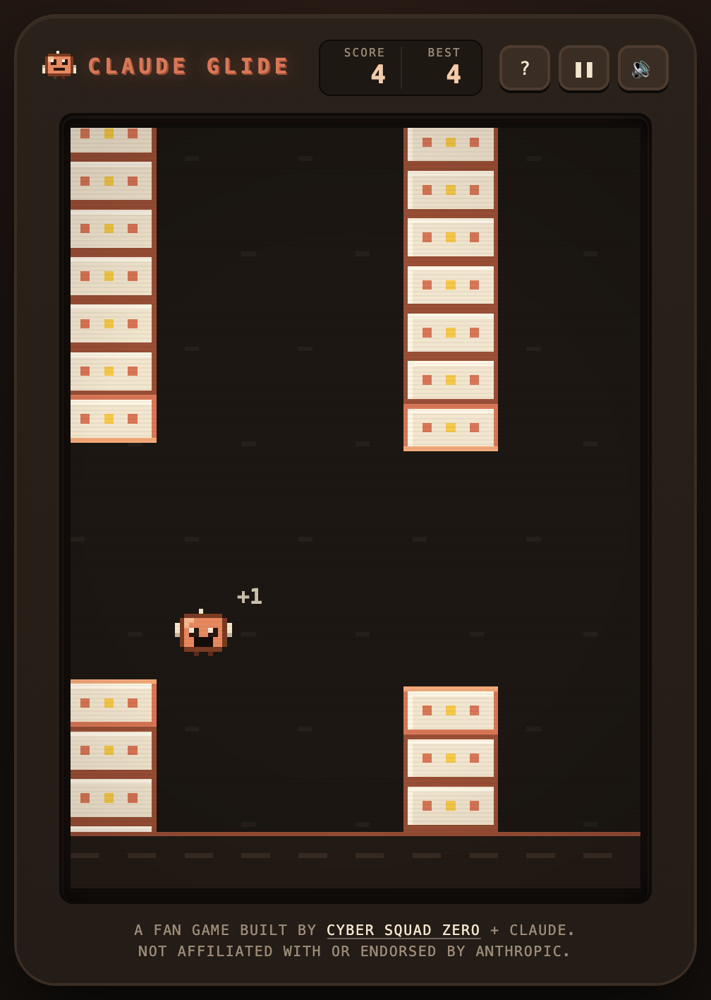
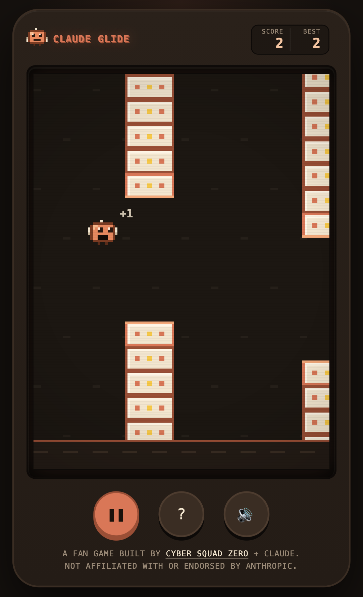

<p align="center">
  
</p>

<h1 align="center">Claude Glide</h1>

<p align="center"><strong>Tap to flap. Thread the gaps. Beat your best.</strong></p>

<p align="center">A free retro arcade fan game inspired by Flappy Bird, for desktop and mobile.<br />Built by <a href="https://www.cs0.dev">CyberSquad0</a> + Claude. The second game in the series after <a href="https://meridian-knight.github.io/claude-swarm/">Claude Swarm</a>.</p>

<p align="center">
  <a href="https://meridian-knight.github.io/claude-glide/"><strong>▶ Play now: meridian-knight.github.io/claude-glide</strong></a>
</p>

<p align="center">
  <a href="https://github.com/meridian-knight/claude-glide/actions/workflows/deploy-pages.yml"></a>
</p>

<table align="center">
  <tr>
    <td align="center" valign="top">
      
    </td>
    <td align="center" valign="top">
      
    </td>
  </tr>
</table>

## How to play

1. **Tap, click or press Space** to flap. Gravity does the rest.
2. **Fly through the gap in every stack** to score a point.
3. **Avoid the stacks and the ground.** One touch ends the run.

Press Start, then the first flap begins the run. The stacks speed up a little and the gaps tighten a little as your score grows, up to a cap. Your best score and the sound setting are remembered in your browser only.

| | Flap | Pause / Resume | Start / Restart | Help |
|---|---|---|---|---|
| **Desktop** | Space, ↑ or W (or click the screen) | P | Enter | `?` button |
| **Touch** | Tap anywhere on the screen | Pause button (below the screen) | Tap Start / Restart | Help button (below the screen) |

Sound starts after your first tap or key press. On iPhone the ring/silent switch also applies. Short vibration feedback plays on scoring and on game over on phones whose browser supports it (Android Chrome); iOS has no vibration API, so nothing is promised there. Opening help pauses a run; backgrounding the page pauses too, and resuming is always your choice.

## Under the hood

- Static site: Vite + TypeScript, no backend, no accounts, no AI API, no network requests once loaded.
- “Agent” is the game’s name for its character. It is a canvas sprite drawn from a 12×12 pixel grid, not an AI agent.
- Game rules live in `src/game/` as pure functions on a fixed 120 Hz step in a 240×320-unit world, with their own unit tests; rendering, input, audio and layout live in `src/ui/`. The world is drawn at one uniform scale and letterboxed, so the scene never stretches and the game plays the same on every screen.
- `?debug` draws the hitboxes and a sizing readout; `?seed=N` makes the stacks reproducible.
- A Content Security Policy meta tag ships with the production page.

## Develop

```bash
npm install
npm run dev          # http://127.0.0.1:5173/
npm run typecheck
npm test             # unit tests (Vitest)
npm run test:e2e     # browser tests (Playwright, desktop + mobile matrix)
npm run build        # production build in dist/
npm run preview      # serve dist/ locally
npm run assets       # regenerate icons and the social preview from the sprite grid
npm run shots        # regenerate the README screenshots (run npm run preview first)
```

`npm run test:e2e` needs Playwright’s browsers: `npx playwright install chromium webkit`.

Resuming work later? Start with [docs/PROJECT-CONTEXT.md](docs/PROJECT-CONTEXT.md): architecture, brand rules, decisions, release process and history, and read-only live checks (`node scripts/verify-live.mjs`, `scripts/audit-start.mjs`, `scripts/audit-help.mjs`, `scripts/smoke.mjs`).

## Deploy

Pushing to `main` runs [`.github/workflows/deploy-pages.yml`](.github/workflows/deploy-pages.yml), which installs from the lockfile, typechecks, runs the unit tests, builds, and publishes `dist/` to GitHub Pages (repository setting: Pages → Source → GitHub Actions). Asset paths are relative, so the build works at a domain root or under the repository sub-path.

To roll back, revert the offending commits on `main` and push; Pages keeps serving the last successful deployment until the new run finishes.

## Credits

Built by **[CyberSquad0](https://www.cs0.dev)** + **Claude**. The game lives at https://meridian-knight.github.io/claude-glide/.

Not affiliated with or endorsed by Anthropic. Not affiliated with the makers of Flappy Bird.
